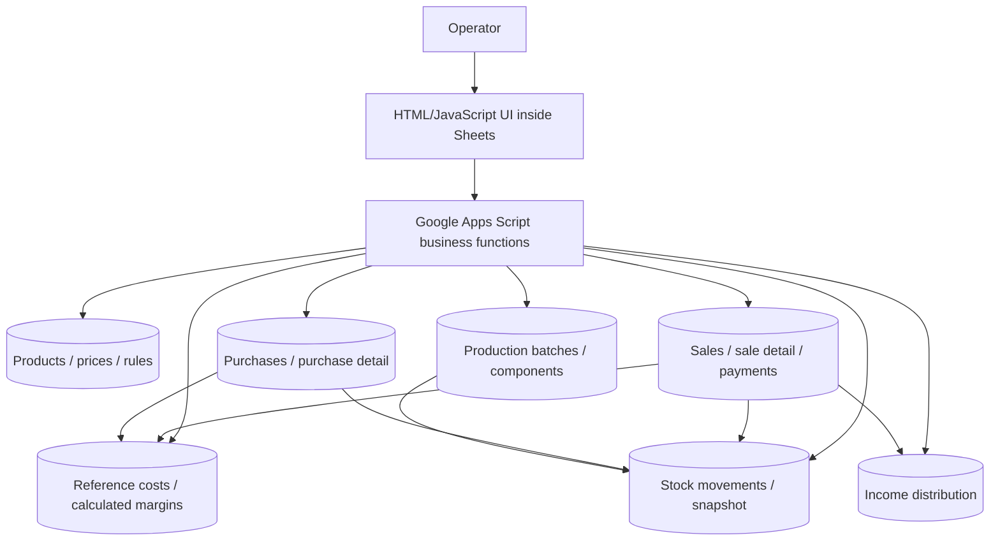
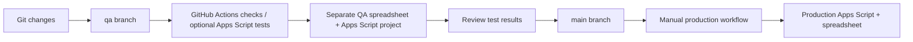

# SuperQTAS — Architecture and controlled releases

This document summarizes the implementation described in the root [README](../README.md), [testing guide](../TESTING_QTAS.md), and [operations guide](../OPERACION_QTAS.md). It is a **logical diagram**, not a claim of distributed infrastructure.

## Runtime and data flow

Arrows indicate logical dependencies, **not** Google Sheets formulas or database foreign keys. Operational records are stored in spreadsheet tabs, coordinated by Apps Script functions. For canonical table names and module responsibilities, use the root README. Do not sum sales and payments as the same revenue: see [Looker guide](../LOOKER_QTAS.md).

## Delivery and environment separation

The diagram is a **recommended conceptual release sequence**, not proof of an enforced branch protection or promotion gate. QA test suites are controlled by repository variables; disabling them means a QA push is not equivalent to passing the full suite. Production deployment is manually triggered. Verify current workflow conditions before relying on any automatic validation.

## Operational concerns

- QA and production must use distinct Apps Script project IDs and spreadsheet IDs. Keep these IDs and OAuth credentials outside the repository.
- Destructive operations are guarded by `QTAS_ALLOW_DESTRUCTIVE`; leave it unset in production.
- The operations guide describes a scheduled backup and **single active backup file**, not a historical retention series. This should not be described as point-in-time recovery.
- Historical inventory entry can be paused; transactions entered while paused deliberately do not modify the current stock snapshot.
- Treat financial, supplier, client and spreadsheet data as private. Use synthetic screenshots and sample records for public demonstrations.

## Suggested demonstration

Show the same anonymized scenario through the sale, payment, calculated margin, and stock snapshot, then show how the change is exercised in QA before a manually approved production deploy. Capture evidence only from a sanitized test spreadsheet.
